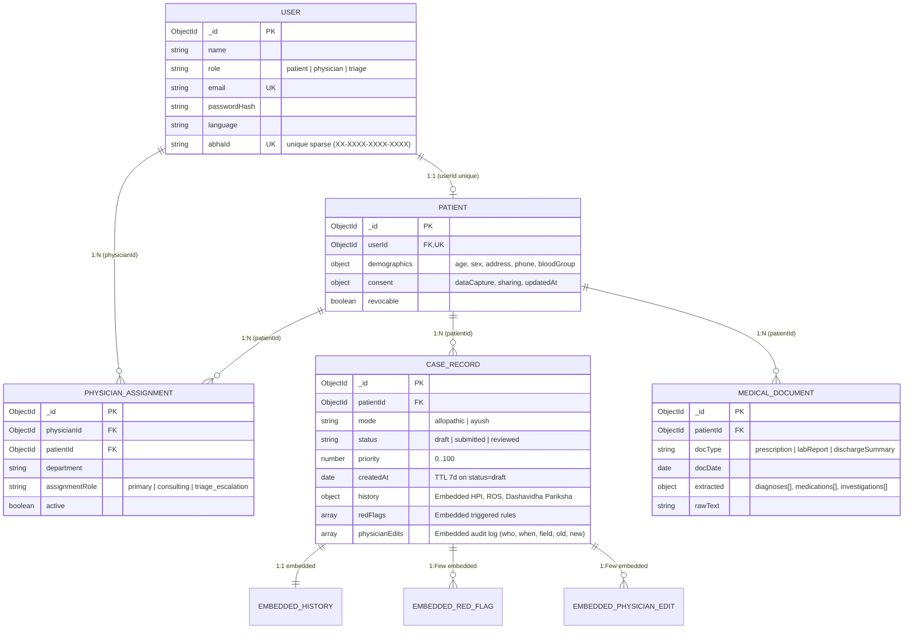

# MediKiosk — Patient Case-Taking & Intelligent Triage Prototype (SIH26047)

**Course**: CSE494 — Intelligent NoSQL Databases Mini-Project  
**Problem Statement**: Smart India Hackathon 2026 — **SIH26047** (*Patient Case-Taking Software*, Ministry of Ayush / All India Institute of Ayurveda — AIIA)

## 1. Overview

**MediKiosk** is a full-stack NoSQL clinical case-taking, medical document extraction, and automated red-flag triage system built on **Node.js, Express, Mongoose, MongoDB, Zod, JWT, Jest + Supertest, and React (Vite) + Tailwind CSS + Recharts**.

- **Patients** record a step-by-step clinical history in either **Allopathic** or **Ayush (Dashavidha Pariksha)** mode, manage revocable data capture/sharing consent, and enter structured prior medical documents (prescriptions, lab reports, discharge summaries).
- **Red-Flag Engine & Abnormal-Lab Flagger** automatically evaluate submitted cases and lab reference ranges against a clinical JSON ruleset, computing a priority score (`0–100`) and attaching structured `redFlags[]`.
- **Triage Staff** monitor a real-time priority queue (`GET /api/triage/queue`) backed by a compound index `{ status: 1, priority: -1, createdAt: 1 }`.
- **Physicians** review auto-structured clinical summaries, edit and confirm findings with an immutable field-level audit trail (`physicianEdits[]`), and inspect a unified chronological patient timeline merging `CaseRecord` and `MedicalDocument` collections.

## 2. Out of Scope & Sensible Assumptions

### Out of Scope
- **Real ASR / Voice-to-Text**: Voice dictation is out of scope; the Patient Kiosk provides a large-text, icon-driven touch interface with a multi-language selector stub (`en`, `hi`, `sa`, `ta`, `mr`).
- **Real OCR / Computer Vision**: Optical character recognition on scanned PDFs/images is out of scope; document `extracted` fields (`diagnoses[]`, `medications[]`, `investigations[]`) and `rawText` are entered manually through the structured Kiosk form.
- **Live ABDM / FHIR Gateway Integration**: External Ayushman Bharat Digital Mission (ABDM) network calls and HL7 FHIR bundle exchanges are out of scope; `abhaId` (`XX-XXXX-XXXX-XXXX`) is validated and indexed locally via a unique sparse MongoDB index.

### Sensible Assumptions Made
1. **Consent Governance**: Patients default to `consent.dataCapture = true` upon registration so they can immediately use the kiosk, but can revoke `dataCapture` or `sharing` at any time via `PATCH /api/patients/:id/consent`. Attempting to create a case while `dataCapture === false` returns `403 Forbidden`.
2. **Draft Privacy & TTL Cleanup**: Cases created in `draft` status are private to the patient (physicians receive `403 Forbidden` if attempting to read a draft) and are automatically purged after **7 days (604,800 seconds)** via a partial TTL index (`partialFilterExpression: { status: "draft" }`).
3. **Lab-Augmented Triage Priority**: When a patient submits a case (`POST /api/cases/:id/submit`), the Red-Flag Engine evaluates both the case's clinical history and the patient's most recent `MedicalDocument` lab investigations so critical lab derangements (e.g., elevated Troponin-I or Potassium) boost triage priority automatically.
4. **Offline Sandbox Compatibility**: For deterministic execution inside offline test environments without an external `mongod` daemon, the repository includes an in-process MongoDB/Mongoose storage engine with full `$jsonSchema` validation, B-tree index bucket lookups, `explain("executionStats")`, and snapshot persistence, while remaining 100% compatible with external MongoDB Community / Atlas via `MONGODB_URI`.

## 3. MongoDB Schema Architecture (Mermaid ER Diagram)



## 4. Demo Accounts (Seeded by `npm run seed`)

| Role | Name | Email | Password | Highlights |
| :--- | :--- | :--- | :--- | :--- |
| **Patient** | Aarav Sharma | `patient@medikiosk.in` | `password123` | Linked ABHA ID `14-2233-4455-6677`, pre-populated Allopathic & Ayush cases and lab reports |
| **Physician** | Dr. Charaka Vaidya | `physician@medikiosk.in` | `password123` | Kayachikitsa & Integrative Medicine reviewer; can edit/confirm cases and inspect timelines |
| **Triage Staff** | Sister Anjali Verma | `triage@medikiosk.in` | `password123` | Access to live priority queue (`/api/triage/queue`) with red-flag badges |

## 5. Setup, Environment Variables & Scripts

### Environment Variables (`.env.example`)
```env
PORT=5000
NODE_ENV=development
MONGODB_URI=mongodb://127.0.0.1:27017/medikiosk
JWT_SECRET=sih26047-medikiosk-ayush-aiia-super-secret-jwt-key-2026
JWT_EXPIRES_IN=24h
VITE_API_URL=http://127.0.0.1:5000
VITE_PORT=5173
```

### Available `npm` Scripts
| Command | Description |
| :--- | :--- |
| `npm test` | Runs all 5 Jest + Supertest test suites (27 tests covering health, models, `$jsonSchema`, CRUD, RBAC, red-flag engine, indexes, covered queries, and aggregations) |
| `npm run seed` | Idempotently seeds 500 patients, 5,000 cases, 3,000 medical documents, 50 physician assignments, and the 3 demo accounts |
| `npm run seed:bulk` | Seeds 100,000 `CaseRecord` documents (`--bulk 100000`) for high-volume testing |
| `npm run benchmark` | Seeds 100,000 `CaseRecord`s, benchmarks queries WITHOUT vs. WITH indexes using `explain("executionStats")`, and writes `docs/performance-report.md` |
| `npm start` | Starts the Express backend API server on `http://127.0.0.1:5000` |
| `npm run dev` | Starts the backend server under `nodemon` |
| `npm run client` | Starts the Vite + React frontend server on `http://127.0.0.1:5173` |

## 6. REST API Reference Table

| Method & Endpoint | Auth / Roles | Description |
| :--- | :--- | :--- |
| `GET /health` | Public | Server & MongoDB connection health check |
| `POST /api/auth/register` | Public | Register a new `patient`, `physician`, or `triage` user (with optional `abhaId` & `demographics`) |
| `POST /api/auth/login` | Public | Authenticate with email & password and receive JWT + linked patient profile |
| `GET /api/auth/me` | All Authenticated | Return current user and linked patient record |
| `POST /api/patients` | All Authenticated | Create patient demographics & consent profile |
| `GET /api/patients` | All Authenticated | Paginated list of patients (patients see only their own profile) |
| `GET /api/patients/:id` | Owner / Staff | Get patient profile by ID (RBAC isolated) |
| `PATCH /api/patients/:id/consent` | Owner / Staff | Toggle `consent.dataCapture` and `consent.sharing` with timestamp |
| `DELETE /api/patients/:id` | Owner / Staff | Delete patient and **cascade delete** all their `CaseRecord`s, `MedicalDocument`s, and `PhysicianAssignment`s |
| `POST /api/cases` | All Authenticated | Create a `CaseRecord` (`allopathic` or `ayush` mode) |
| `GET /api/cases` | All Authenticated | Paginated cases (patients see own; physicians see `submitted`/`reviewed` only; supports `?search=` text index) |
| `GET /api/cases/patient/:patientId` | Owner / Staff | Chronological cases for a patient using `{ patientId: 1, createdAt: -1 }` index |
| `POST /api/cases/:id/submit` | Owner / Staff | Run Red-Flag Engine & Abnormal-Lab Flagger, compute `priority`, and mark `submitted` |
| `PATCH /api/cases/:id/review` | `physician` | Edit structured case fields, append audit entries to `physicianEdits[]`, and mark `reviewed` |
| `POST /api/documents` | All Authenticated | Upload prior medical document and automatically flag abnormal lab values against `refRange` |
| `GET /api/documents/patient/:patientId/timeline` | Owner / Staff | Chronological patient timeline of medical documents and clinical cases |
| `GET /api/triage/queue` | `triage`, `physician` | Priority queue sorted by `priority DESC, createdAt ASC` (supports `?covered=true`) |
| `GET /api/analytics/cases-per-day` | All Authenticated | Aggregation: cases per day and per mode (`$group`, `$dateToString`) |
| `GET /api/analytics/top-complaints` | All Authenticated | Aggregation: top 10 chief complaints (`$group`, `$sort`, `$limit`) |
| `GET /api/analytics/abnormal-labs` | All Authenticated | Aggregation: abnormal lab frequency (`$unwind`, `$match`, `$group`) |
| `GET /api/analytics/patient-timeline/:patientId` | All Authenticated | Aggregation: unified patient timeline (`$lookup`, `$unionWith`, `$sort`) |
| `GET /api/analytics/red-flags-per-week` | All Authenticated | Aggregation: weekly red-flag counts (`$unwind`, `$group`, `$dateToString`) |
| `GET /api/analytics/covered-query` | All Authenticated | Demonstrates covered index query (`PROJECTION_COVERED`, `totalDocsExamined: 0`) |
